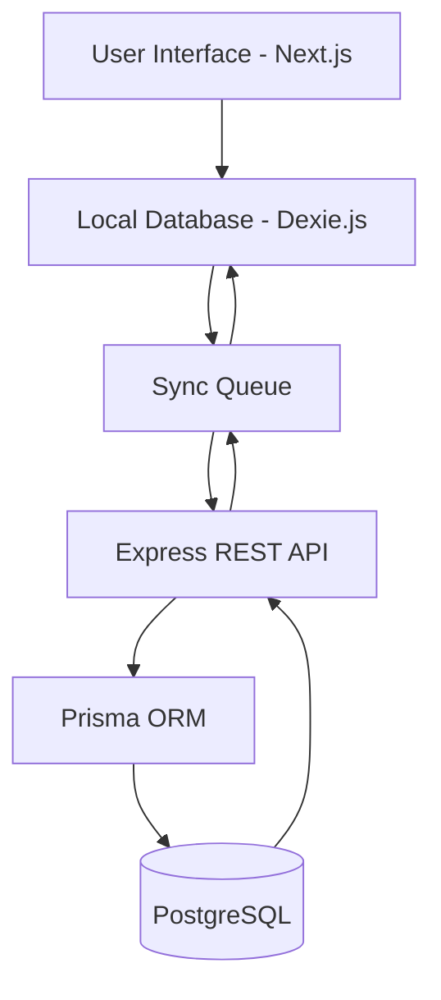

# Personal Finance Assistant 💰

**A personal financial management application built to give you complete visibility and control over your money.**

Personal Finance Assistant is an offline-capable, installable financial management application designed to centralize personal finances across multiple accounts and currencies.

It helps manage income, expenses, transfers, recurring transactions, account balances, and financial reports through one consistent financial system.

The project focuses on financial accuracy, data integrity, privacy, and a reliable user experience across desktop and mobile devices.

---

## 🎯 Project Goals

- Centralize personal financial information in one application.
- Track income, expenses, transfers, and account balances.
- Support multiple financial accounts and currencies.
- Maintain accurate financial records and transaction history.
- Work offline and synchronize data when connectivity returns.
- Provide meaningful financial reports and spending insights.
- Build a secure, installable Progressive Web Application (PWA).

**Product scope:** Initially designed for personal use, without shared household accounts or unnecessary multi-user SaaS complexity.

---

## ✨ Features & Product Roadmap

### 1. Account Management

Manage financial accounts from a centralized workspace.

- Cash accounts.
- Bank accounts.
- Credit cards.
- Savings accounts.
- Digital wallets.
- Multiple currencies: EGP, USD, and EUR.
- Individual account balances.
- Account transaction history.

### 2. Transaction Management

Four primary transaction types:

| Transaction | Description |
|---|---|
| Income | Money received |
| Expense | Money spent |
| Transfer | Money moved between owned accounts |
| Adjustment | Balance correction with audit history |

Additional capabilities:

- Create, edit, and soft-delete transactions.
- Predefined and custom categories.
- Transaction descriptions and notes.
- Transaction dates.
- Receipt and document attachments.
- Refund management using the Refunds income category.
- Transaction history and audit trail.

**Financial integrity rule:** Transfers between owned accounts must never be counted as income or expenses.

### 3. Category Management

- Predefined income categories.
- Predefined expense categories.
- Custom categories.
- Category-based transaction filtering.
- Category-based financial reporting.
- Refunds category.

### 4. Recurring Transactions

Manage repeating financial activities.

- Recurring income.
- Recurring expenses.
- Monthly subscriptions.
- Installments.
- Recurring payment schedules.
- Upcoming financial obligations.

### 5. Financial Dashboard

A centralized overview of personal financial activity.

- Total account balances.
- Individual account balances.
- Income and expenses summaries.
- Monthly financial overview.
- Spending by category.
- Recent transactions.
- Financial trends.

### 6. Financial Reports & Export

- Income vs. expenses reports.
- Category spending breakdown.
- Account statements.
- Monthly financial summaries.
- CSV export.
- Excel export.
- PDF export.

### 7. Transaction Attachments

- Image attachments.
- PDF receipts and documents.
- Maximum attachment size: 10 MB.
- Attachments associated with individual transactions.

### 8. Security & Privacy

- Secure authentication.
- Application lock after 5 minutes of inactivity.
- Biometric re-authentication.
- No PIN-based application lock.
- Transaction audit history.
- Soft deletion for important financial records.

### 9. Offline-First PWA

Designed to provide a native-like experience across desktop and mobile.

- Installable Progressive Web Application.
- Standalone application experience.
- Offline access to locally available data.
- IndexedDB local persistence.
- Dexie.js local database management.
- Background synchronization when connectivity returns.
- Sync Queue for pending operations.
- Reliable synchronization between local storage and backend.

---

## 🏗️ Technology Stack

### Frontend

- Next.js
- React
- TypeScript
- Tailwind CSS
- Progressive Web Application (PWA)

### Backend

- Node.js
- Express.js
- TypeScript
- RESTful APIs

### Database & Data Management

- PostgreSQL
- Prisma ORM
- IndexedDB
- Dexie.js

### Monorepo & Development Tools

- pnpm Workspaces
- Turborepo
- Docker
- Git

---

## 🧩 System Architecture

The application follows a modular monorepo architecture.

```text
personal-finance-assistant/
│
├── apps/
│   ├── api/                  # Backend API
│   │   ├── src/
│   │   └── prisma/
│   │
│   └── web/                  # Frontend PWA
│       ├── src/
│       └── public/
│
├── packages/
│   └── shared/               # Shared types and utilities
│
├── package.json
├── pnpm-workspace.yaml
└── turbo.json
```

### Data Flow



The local database provides offline capabilities, while the backend provides persistent centralized storage and synchronization.

---

## 🔐 Engineering Principles

The project follows these core engineering principles:

- **Financial Accuracy:** All financial calculations must be deterministic and consistent.
- **Data Integrity:** Transactions and account balances must remain correct.
- **Auditability:** Important financial changes must be traceable.
- **Offline Reliability:** Local operations must survive temporary connectivity loss.
- **Synchronization Safety:** Avoid duplicate operations and inconsistent data.
- **Security First:** Protect financial information and authentication.
- **Maintainability:** Prefer simple, modular, maintainable solutions over unnecessary abstractions.

---

## 🗺️ Development Roadmap

The project is developed incrementally, with each phase tested before moving forward.

| Phase | Scope | Status |
|---|---|---|
| 01 | Monorepo & development environment | Foundation |
| 02 | Database architecture & Prisma | Foundation |
| 03 | Authentication & user security | In progress |
| 04 | Account management | Planned |
| 05 | Transaction management | Planned |
| 06 | Categories & financial rules | Planned |
| 07 | Financial dashboard | Planned |
| 08 | Recurring transactions | Planned |
| 09 | Offline database & Sync Queue | Planned |
| 10 | Reports & exports | Planned |
| 11 | Attachments management | Planned |
| 12 | PWA & application security | Planned |
| 13 | Testing, deployment & optimization | Planned |

*Roadmap statuses are indicative and should be updated as features are implemented and verified.*

---

## 🔮 Future Possibilities

Features intentionally deferred until the core financial system is reliable:

- AI-powered CFO assistant.
- Intelligent spending analysis.
- Personalized financial recommendations.
- Advanced financial planning.
- Advanced financial analytics.

---

## ⚙️ Development Environment

### Prerequisites

- Node.js 24+
- pnpm
- PostgreSQL
- Git

### Getting Started

Clone the repository:

```bash
git clone <your-repository-url>
cd personal-finance-assistant
```

Install dependencies:

```bash
pnpm install
```

Start development:

```bash
pnpm dev
```

The backend API currently runs at:

```text
http://localhost:4000
```

---

## 🚀 Deployment Strategy

The project is intended to maintain separate environments:

- Development
- Staging
- Production

Each environment should have its own configuration and database credentials.

---

## 👨‍💻 Project Philosophy

This is more than an expense tracker.

The objective is to build a reliable personal financial system that provides accurate financial visibility, preserves transaction history, and makes managing money easier.

**Built with a focus on financial integrity, simplicity, and long-term maintainability.**
